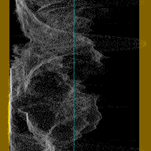
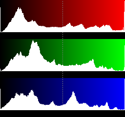
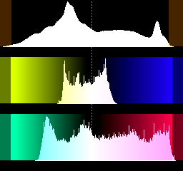
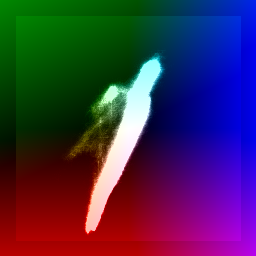
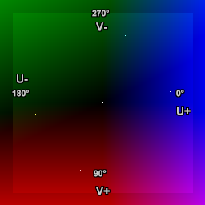
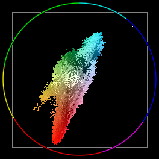
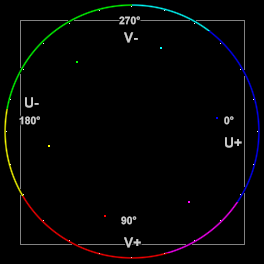
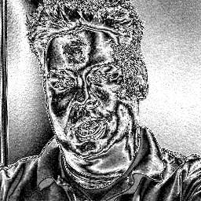
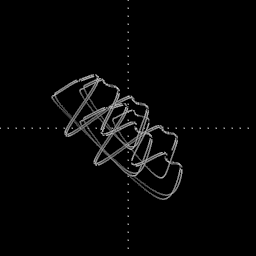
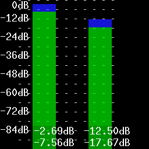

Histogram
=========
A multipurpose audio/video analysis tool.

Syntax and Parameters
----------------------
::

    Histogram (clip, string "mode", float "factor", int "bits", bool "keepsource", bool "markers",
    string "matrix", 
    string "graticule", bool "targets", bool "axes", bool "iq", bool "iq_lines", bool "circle", 
    bool "targets100")

.. describe:: clip

    Source clip; bit depths greater than 8 are supported in Classic, Levels,
    Luma and Colors modes only.

    * Classic, Color, Color2 and Luma modes support all planar YUV(A) formats.
    * Levels mode support RGB24/32/48/64 and all planar RGB(A)/YUV(A) formats.
    * Audiolevels and StereoOverlay modes support all 8-bit YUV(A) formats.
    * Stereo and StereoY8 accept any 8-bit format but always return a 512x512
      YUV420P8 or a Y8 clip respectively. If only an audio clip is given then
      the output clip will have a framerate of 25FPS.
    * Audiolevels and Stereo* modes support all audio samples types.

.. describe:: mode

    Select the ``mode`` to display:

    * :ref:`"Classic" <histogram-classic>` : waveform mode;
    * :ref:`"Levels" <histogram-levels>` : RGB/YUV/Y histogram mode;
    * :ref:`"Color" <histogram-color>` : vectorscope mode;
    * :ref:`"Color2" <histogram-color2>` : vectorscope mode with overlays;
    * :ref:`"Luma" <histogram-luma>` : special viewing mode;
    * :ref:`"Audiolevels" <histogram-audiolevels>` : audio level meter; and
    * :ref:`"Stereo", "StereoOverlay", "StereoY8" <histogram-stereo>` : audio graphs.

    Default: "classic"

.. describe:: factor

    Applies only to Levels mode.
    The ``factor`` option specifies the way how the graphs are displayed,
    exaggerating the vertical scale. It is specified as percentage of the total
    population (that is number of luma or chroma pixels in a frame). For example,
    ``Histogram("Levels", 1.5625)`` will achieve a 1/64th cap. The vertical scale
    is multiplied by 100.0 / ``factor``.

    | Range: 0.0 - 100.0
    | Default: 100.0

.. describe:: bits

    Accepts 8, 9, 10, 11 or 12 as input. Applies only to Classic, Levels and
    Color/Color2 (vectorscope) modes.

    * Classic, Levels: increases the width of the histogram by 2\ :sup:`(bits-8)`
    * Color/Color2: increases width and height of the histogram by 2\ :sup:`(bits-8)`

    For example, ``Histogram(bits=10)`` returns a 1024-pixel wide histogram
    (width is 256 by default).

    Default: 8

.. describe:: keepsource

    If true, add histogram to right side of existing clip; else return the
    histogram portion only. Applies only to Classic, Levels, Color and Color2 modes.

    Default: true

.. describe:: markers

    If true, show calibration marks (see screenshots); else hide them.
    For Levels mode it will also remove the colored background. Applies only to
    Classic and Levels modes.

    Default: true

.. describe:: matrix

    Applies to Color/Color2 mode. Specifies the YUV matrix used to interpret the
    chroma values of the input clip, and determines the correct U/V positions of
    the color bar target boxes and I/Q markers drawn on the vectorscope.

    Accepted values follow the same convention as the ``ConvertToYUV`` family of
    functions, for example: ``"2020"``, ``"709"``, etc..

    If not specified, the matrix is read from the clip's ``_Matrix`` and
    ``_ColorRange`` frame properties. If those are absent, BT.601 is assumed.

    Default: (empty, means auto from frame properties or else BT.601)

.. describe:: graticule

    Applies only to Color and Color2 modes. Controls the visibility of the
    graticule overlay — the valid chroma range boundary square (16–240 in 8-bit,
    scaled for higher bit depths) in Color2 mode, and the danger zone shading in
    Color mode.

    * ``"on"`` (default): Always draw the graticule, regardless of the clip's
      color range. This preserves the behavior of versions prior to 3.7.6.
    * ``"off"``: Never draw the graticule.
    * ``"auto"``: Draw the graticule only for limited-range clips. For full-range
      clips, where the valid chroma area extends to the display edges, the
      graticule is suppressed to avoid clutter.

    Default: ``"on"``

.. describe:: targets

    Applies only to Color and Color2 modes. If true, draw small target boxes
    on the vectorscope at the expected Cb/Cr positions of the six 75%-amplitude
    colour bar colours (Yellow, Cyan, Green, Magenta, Red, Blue). The positions
    are computed from ground-truth linear RGB values converted through the active
    ``matrix``, and the limited or full range property of the clip, giving
    accurate targets for any supported matrix and bit depth.

    The target positions correspond to the 75% signal level as used by
    :doc:`ColorBars <colorbars>` and :doc:`ColorBarsHD <colorbars>`. They are
    also the correct reference positions for :doc:`ColorBarsUHD <colorbarsuhd>`
    content after SDR conversion, since the three test patterns share the same
    scene light level at their respective reference amplitudes:

    * **ColorBarsHD** 75% bars → land on 75% targets directly.
    * **ColorBarsUHD HLG** (mode=0) 75% BT.709-equivalent bars → land on 75%
      targets after scene-referred HLG→SDR conversion (ITU Fig. 10).
    * **ColorBarsUHD PQ** (mode=1) 58% BT.709-equivalent bars → land on 75%
      targets after scene-referred PQ→SDR conversion at 1000 cd/m² reference,
      because the 58% PQ signal level corresponds to the same scene light as
      75% HLG at the 1000 cd/m² reference (203 cd/m² diffuse white).

    For the **HLG/PQ source signal** (before SDR conversion), convert to YUV
    first and set ``matrix`` to ``"709"`` (or ``"2020"`` all the same, drawing is
    matrix-aware) to see the BT.709-equivalent bottom bars land on 75% targets::

        src = ColorBarsUHD(pixel_type="RGBP10", mode=0)
        src.ConvertToYUV444(matrix="709:same").Histogram("color2", targets=true)

    Default: false

.. describe:: targets100

    Applies only to Color and Color2 modes. If true, draw small target boxes
    on the vectorscope at the expected Cb/Cr positions of the six **100%**-amplitude
    colour bar colours. The positions are computed from the same ground-truth
    linear RGB primaries as ``targets``, scaled to full saturation (100% signal
    level), using the active ``matrix`` and colour range.

    These targets are useful for validating HDR-to-SDR conversions where HDR
    primary colour bars exceed the SDR gamut and are hard-clipped. Specifically,
    after a **scene-referred** HLG→SDR or PQ→SDR conversion, the 75% HLG and
    58% PQ primary colour bars (Row 2 of ColorBarsUHD) clip to exactly 100% SDR
    amplitude and should land on these targets:

    * fmtconv scene-referred: bars land **exactly** on the 100% targets —
      confirming high numerical precision of the analytical conversion path.
    * zimg/avsresize scene-referred (as of 20260317 patch needed): bars land 
      approximately on the 100% targets with small scatter — due to LUT quantisation 
      in the per-channel gamma path.
    * Display-referred conversion: bars land approximately near the 100% targets
      but with visible scatter between bars of the same hue group, because the
      luminance-weighted OOTF scales each bar by a different factor depending on
      its luminance content. This scatter is physically correct and expected —
      the BT.709-equivalent bars were designed to hit targets for scene-referred
      conversion only (per ITU-R BT.2111-3 Attachment 3).

    Default: false

    See also :ref:`ColorbarsUHD vectorscope example <ColorBarsUHD_vectorscope_example>`

.. describe:: axes

    Applies only to Color and Color2 modes. If true, draw horizontal and vertical crosshair
    lines through the center of the vectorscope, marking the U (Cb) and V (Cr)
    axes.

    Default: false

.. describe:: iq

    Applies only to Color and Color2 modes. If true, draw target boxes for the NTSC −I, and
    +Q (ColorBars) and +I (ColorBarsHD) chroma-phase reference signals. These are 
    defined by the luma-corrected broadcast convention (Option 2 below) and are 
    computed through the active ``matrix``. 

    The −I and +Q signals are traditionally zero-luma, 20 IRE saturation chroma
    axis references from the NTSC subcarrier standard. Three interpretations exist
    in digital studio-swing environments:

    For displaying them on RGB or YUV, "hack" is needed to reach valid RGB/YUV values, 
    for more information see ColorBars documentation.

    Default: false

.. describe:: iq_lines

    Applies only to Color and Color2 modes. If true, draw radial lines on the vectorscope
    passing through the −I/+I and +Q/−Q axis positions. Together with ``axes``,
    this produces the full eight-line graticule (four cardinal lines at 0°/90°/
    180°/270° and four diagonal lines through the I/Q phase references) commonly
    seen on broadcast vectorscopes.

    The diagonal line angles are not derived from the actual computed I/Q U/V
    positions, and use always textbook values of 33°/123°.

    Default: false

.. describe:: circle

    Applies only to Color and Color2 modes. If true (default for color2), draws 
    hue circle with 15° tick marks around the circumference.

    Default: true ("color2"), false ("Color")

.. _histogram-classic:

Classic mode
------------

This will add a per-line luminance graph (called a `Waveform Monitor`_) on the
right side of the video. The left side of the graph represents the minimum pixel
value (0) and the right side represents the maximum pixel value (for example,
255 for 8-bit). Values outside the valid  :doc:`CCIR-601 <limiter>` range are
shown in a brown/yellow-ish color, and a greenish line represents the midpoint
for limited range (e.g. 126 for 8-bit since the median of [16,235] is 125.5).

|clearfloat|

.. _histogram-levels:

Levels mode
-----------

This mode will display three `histograms`_ on the right side of the video frame.
This will show the distribution of the R,G,B or Y,U,V components in the current
frame.

The top graph displays the luma (R) or red (Y) distribution of the frame, where
the left side represents the minimum pixel value (0) and the right side
represents the maximum pixel value (for example, 255 for 8-bit). For YUV, the
valid :doc:`CCIR-601 <limiter>` range has been indicated by a slightly different
color. The midpoint is marked with a dotted line (for example, 128 for 8-bit).
The vertical axis shows the number of pixels for a given luma (Y) value. The
middle graph is similar and displays the G or U component, and the bottom graph
displays the B or V component.

|clearfloat|

.. _histogram-color:

Color mode
----------

This mode displays the chroma values (U/V color placement) in a two-dimensional
graph called a `vectorscope`_, appended to the right side of the video frame.
It functions as a histogram at the same time: the whiter a pixel in the
vectorscope, the more pixels of the input clip share that chroma value. The
shaded background denotes the valid :doc:`CCIR-601 <limiter>` range (danger zone
shading can be controlled with the ``graticule`` parameter).

Labels have been added to the second image for reference, showing the U and V
axes and degrees of hue. Spots show 75% saturated :doc:`ColorBars <colorbars>`
(clockwise from 0°: blue, magenta, red, yellow, green and cyan).

The U component is displayed on the horizontal (X) axis (left = 0, right = 255)
and the V component on the vertical (Y) axis (top = 0, bottom = 255).

A spot's position on the scope corresponds to a chroma value from the input
clip. As hue changes, the spot moves around the center; as saturation changes,
it moves in or out. The center (U=V=128) represents zero saturation — no color.
At U=255, V=128 the hue is zero (blue) at maximum saturation:
saturation = sqrt( (U-128)\ :sup:`2` + (V-128)\ :sup:`2` ) = 127.
Turning hue clockwise 90° gives U=128, V=255 (red, approximately). Decreasing
saturation at constant hue moves the spot toward the center, fading the color
to :doc:`greyscale <greyscale>`.

|clearfloat|

.. _histogram-color2:

Color2 mode
-----------

This mode displays pixels in a two-dimensional `vectorscope`_ appended to the
right side of the video frame. It can be used to read the `hue`_ and
`saturation`_ of a clip.

The U and V axes are laid out identically to **Color** mode (see above).
The grey square (graticule) denotes the valid limited-range Cb/Cr boundary
(16–240 in 8-bit; see also :doc:`CCIR-601 <limiter>`).

As in **Color** mode, labels and :doc:`ColorBars <colorbars>` dots have been
added to the second image for reference.

Unlike **Color** mode, the background is black rather than shaded, the signal
dots are brighter and rendered in color, and a color wheel is drawn around the
circumference of the scope divided into six hues (clockwise from 0°: blue,
magenta, red, yellow, green and cyan) with white tick marks at 15° intervals.

|clearfloat|

.. _histogram-vectorscope-overlays:

Vectorscope overlays: Color and Color2
---------------------------------------

Both **Color** and **Color2** modes share a common set of optional overlays.
The fundamental difference between the two modes is that **Color** operates as
a density histogram plotted over a pre-drawn UV shade background, while
**Color2** plots individual pixels on a black background with a color wheel.

Both modes are matrix-aware: the ``matrix`` parameter (or the clip's ``_Matrix``
and ``_ColorRange`` frame properties) controls how chroma values are interpreted
and where overlay markers are positioned, giving accurate results for BT.601,
BT.709, BT.2020 and other supported matrices at all bit depths.

**Optional overlays:**

+-------------+-------------------+-------------------+------------------------------------------+
| Parameter   | Color default     | Color2 default    | Description                              |
+=============+===================+===================+==========================================+
| graticule   | ``"on"``          | ``"on"``          | Danger zone shading (Color) or valid     |
|             |                   |                   | chroma boundary square (Color2).         |
|             |                   |                   | ``"on"`` / ``"off"`` / ``"auto"``        |
|             |                   |                   | (auto: limited-range only).              |
+-------------+-------------------+-------------------+------------------------------------------+
| targets     | false             | false             | Target boxes at the six 75% colour bar   |
|             |                   |                   | Cb/Cr positions. Matrix-aware. Useful    |
|             |                   |                   | for ColorBars, ColorBarsHD, and          |
|             |                   |                   | ColorBarsUHD after SDR conversion.       |
+-------------+-------------------+-------------------+------------------------------------------+
| targets100  | false             | false             | Target boxes at the six 100% colour bar  |
|             |                   |                   | Cb/Cr positions. Matrix-aware. Useful    |
|             |                   |                   | for validating HDR primary bars after    |
|             |                   |                   | SDR conversion where HLG/PQ primaries    |
|             |                   |                   | clip to 100% SDR amplitude.              |
+-------------+-------------------+-------------------+------------------------------------------+
| axes        | false             | false             | Horizontal and vertical crosshair        |
|             |                   |                   | through the scope center.                |
+-------------+-------------------+-------------------+------------------------------------------+
| iq          | false             | false             | Target boxes for the NTSC −I, +I         |
|             |                   |                   | and +Q phase references.                 |
+-------------+-------------------+-------------------+------------------------------------------+
| iq_lines    | false             | false             | Radial lines at the fixed 33°/123°       |
|             |                   |                   | NTSC I/Q phase angles.                   |
+-------------+-------------------+-------------------+------------------------------------------+
| circle      | false             | true              | Hue circle with 15° tick marks around    |
|             |                   |                   | the circumference.                       |
+-------------+-------------------+-------------------+------------------------------------------+

**Example usage**::

    # ColorBars / ColorBarsHD: 75% targets with BT.601/BT.709 auto-detected
    ColorBars()
    Histogram("color2", targets=true, axes=true, iq=true, iq_lines=true)

    # ColorBarsHD with explicit BT.709 matrix
    # Here unnecessary, "color2" knows it from frame properties set to 709,limited
    ColorBarsHD()
    Histogram("color2", targets=true, matrix="709:l")

    # ColorBarsUHD HLG source: view in BT.2020 Cb/Cr space
    # BT.709-equivalent bottom bars land on BT.2020 75% targets
    ColorBarsUHD(pixel_type="RGBP10", mode=0)
    Histogram("color2", targets=true, targets100=true)

    # ColorBarsUHD HLG after scene-referred SDR conversion:
    # 75% HLG primary bars clip to 100% SDR → use targets100
    # BT.709-equivalent bottom bars land on 75% targets → use targets
    z_ConvertFormat(last, pixel_type="RGBP10",
        \ colorspace_op="auto:auto:auto:l=>rgb:709:709:l",
        \ nominal_luminance=203.15, use_props=1,
        \ approximate_gamma=false, scene_referred=true)
    ConvertToYUV444(matrix="709:same")
    Histogram("color2", targets=true, targets100=true)

    # Override matrix interpretation to BT.709 for an SD clip tagged as 601
    Histogram("color2", matrix="709", targets=true, iq=true)

    # Suppress the graticule only for full-range clips
    Histogram("color2", graticule="auto")

    # Switch on all overlays in Color mode
    Histogram("color", graticule="on", targets=true, targets100=true,
        \ axes=true, iq=true, iq_lines=true, circle=true)

See also
:ref:`ColorbarsUHD vectorscope example <ColorBarsUHD_vectorscope_example>`

|clearfloat|

.. _histogram-luma:

Luma mode
---------

This mode will amplify luminance, and display very small luminance
variations. This is good for detecting blocking and noise, and can be helpful
at adjusting filter parameters. In this mode a 1-pixel luminance difference
will show as a 16-pixel luminance pixel, thus seriously enhancing small
flaws.

|clearfloat|

.. _histogram-stereo:

Stereo, StereoY8 and StereoOverlay mode
---------------------------------------

This mode shows a stereo graph (known as a `goniometer`_ or phase scope), from
the audio in the clip. This can be used to see the left-right and phase
distribution of the input signal. Each frame will contain only information from
the current frame to the beginning of the next frame. The signal is linearly
upsampled 8x, to provide clearer visuals. Only **StereoOverlay** will overlay
the graph on top of the source clip. **Stereo** and **StereoY8** just return a
512x512 clip of the graph.

|clearfloat|

.. _histogram-audiolevels:

AudioLevels mode
----------------

Shows the audio levels in `decibels`_ for each channel present. For example, if
the source has six channels of audio, six vertical bars will be shown. The audio
levels are overlaid over the source clip.

The green bars show the *RMS* level and the blue bars show the *max* (peak)
level, both are calculated with the formulas listed below. The color of the bar
changes color to red and yellow whenever that specific channel's peak reaches
0.0dB.

|clearfloat|

**Formulas**

The green bars show the *RMS* (`Root Mean Square`_) level of the audio in each
video frame (let's say *n* samples) using the following formula:

.. math::  RMS = 20 * \log_{10}(1 / 32768 * \sqrt{1/n * \sum_{j=1}^n sample(j)^2})

The blue bars show the *max* (peak) level of the audio in each video frame
using the following formula:

.. math:: max = 20 * \log_{10}(max_{\text{j}}(sample(j))/32768)

The maximum possible level without `clipping`_ is 0 dB by definition. The
minimum level for 16 bit audio is therefore:

.. math:: 20 * \log_{10}(1/32768) = -90.31 dB \qquad (\text{since} \quad 2^{16} / 2 = 32768)

Changelog
---------

+-----------------+-------------------------------------------------------------+
| Version         | Changes                                                     |
+=================+=============================================================+
| AviSynth+ 3.7.7 || Fix: "Classic", "Levels", "Color": alpha plane of the      |
|                 |  histogram area was not set, now opaque.                    |
|                 || "Color2": alpha of the histogram area is opaque, was 0.    |
|                 || Fix: "Color2": U or V at the top of the range was plotted  |
|                 |  outside the panel when ``bits`` was below the clip depth.  |
|                 || Fix: "Levels", 32 bit float, limited range: luma bars were |
|                 |  16 levels too high. "Classic" float with ``bits`` above 8. |
|                 || Fix: "Levels" on Y+Alpha clips, works as on greyscale.     |
+-----------------+-------------------------------------------------------------+
| AviSynth+ 3.7.6 || Vectorscope modes: added ``matrix``, ``graticule``,        |
|                 |  ``targets``, ``axes``, ``iq``, ``iq_lines``, ``circle``    |
|                 |  parameters.                                                |
|                 || Vectorscope modes: matrix-aware; target box                |
|                 |  and I/Q overlay positions are computed from ground-truth   |
|                 |  linear 75% RGB values through the active YUV matrix, giving|
|                 |  accurate results for BT.601, BT.709, BT.2020 and other     |
|                 |  supported matrices at all bit depths including float.      |
|                 || Vectorscope modes: copy alpha from clip, initialize alpha  |
|                 |  to zero in the histogram area.                             |
|                 || Vectorscope modes: accurate pixel positioning and scaling  |
|                 |  to the active histogram area, limited/full range aware.    |
+-----------------+-------------------------------------------------------------+
| AviSynth+ 3.7.2 || Added support for all YUV(A) formats (10-16 bit and float) |
|                 |  in "Luma" mode.                                            |
|                 || Fix: prevent crash when factor=0 in "Levels" mode.         |
|                 || Fix: "Levels" mode: fix incorrect "factor" applied for U/V |
|                 |  part drawing when format was subsampled (non-444).         |
|                 || Make "factor" a named parameter (previously an unnamed     |
|                 |  optional parameter).                                       |
|                 || Fix: check for Planar RGB in "Audiolevels", "Color",       |
|                 |   "Color2" and "StereoOverlay" modes.                       |
|                 || Levels mode: stop using shades of grey on top of bars.     |
|                 || Levels mode: use bar color 255 for RGB instead of Y's 235. |
|                 |  (and scaled equivalents).                                  |
|                 || Fix: "Color" mode may crash on certain dimensions for      |
|                 |  subsampled formats.                                        |
|                 || Fix: "Color2" missing CCIR rectangle top and bottom line.  |
+-----------------+-------------------------------------------------------------+
| AviSynth+ 3.7.0 | Added support for all YUV(A) formats (10-16 bit and float)  |
|                 | in "Color2" mode.                                           |
+-----------------+-------------------------------------------------------------+
| AviSynth+ 3.6.1 | Added greyscale support in "Levels" mode.                   |
+-----------------+-------------------------------------------------------------+
| AviSynth+ 3.4.0 || Added ``keepsource`` and ``bits`` parameters.              |
|                 || Added support for RGB24/32/48/64 and all planar            |
|                 |  RGB(A)/YUV(A) formats in "Levels" mode.                    |
|                 || Added support for all YUV(A) formats (10-16 bit and float) |
|                 |  in "Classic" mode.                                         |
+-----------------+-------------------------------------------------------------+
| AviSynth 2.6.0  || Added "StereoY8" mode.                                     |
|                 || Added factor option to "Levels" mode.                      |
|                 || Improve colour of chroma legends in "Levels" mode.         |
+-----------------+-------------------------------------------------------------+
| AviSynth 2.5.8  || Added "Color2" and "AudioLevels" modes.                    |
|                 || Added YV12 support.                                        |
+-----------------+-------------------------------------------------------------+
| AviSynth 2.5.6  | Added invalid colors in YUY2 mode.                          |
+-----------------+-------------------------------------------------------------+
| AviSynth 2.5.5  | Added dots to "Stereo" mode to show bias/offsets.           |
+-----------------+-------------------------------------------------------------+
| AviSynth 2.5.4  | Added "Luma", "Stereo", and "StereoOverlay" modes.          |
+-----------------+-------------------------------------------------------------+
| AviSynth 2.5.3  | Added ``mode`` parameter and "Levels" and "Color" modes.    |
+-----------------+-------------------------------------------------------------+
| AviSynth 2.5.0  | Added markers to show invalid colors in YUV. Invalid values |
|                 | (below 16 and above 235) will be colored brown/yellow-ish.  |
+-----------------+-------------------------------------------------------------+

$Date: 2026/02/19 $

.. _histograms:
    https://en.wikipedia.org/wiki/Color_histogram
.. _Waveform Monitor:
    https://en.wikipedia.org/wiki/Waveform_monitor
.. _vectorscope:
    https://en.wikipedia.org/wiki/Vectorscope
.. _hue:
    https://en.wikipedia.org/wiki/Hue
.. _saturation:
    https://en.wikipedia.org/wiki/Colorfulness#Saturation
.. _decibels:
    https://en.wikipedia.org/wiki/Decibel
.. _Root Mean Square:
    https://en.wikipedia.org/wiki/Root_mean_square
.. _clipping:
    https://en.wikipedia.org/wiki/Clipping_(audio)
.. _goniometer:
    https://en.wikipedia.org/wiki/Goniometer_(audio)

.. |clearfloat|  raw:: html

    

